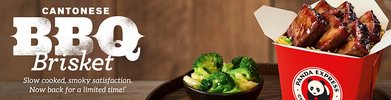

{fig-alt="Image"}

What a day today was. It was ordinary in a sense. My day job was uneventful. I do market research, and I have been working on some brand measurement research which basically looks at brand relevance. I am writing some findings for a client who is looking at how they can measure their brand relevance, so I am suggesting combining some measures from Edelman and Microsoft. I will spare you the details, but the readings today were fun in a geeky market research way.

Anyway, I also teach at night (sociology), so around 4:30 I headed out to campus. Traffic was a bit heavy; it took me almost 1 hr for a 25-mile drive. I decided to listen to Marillion. I was a big Marillion fan, especially Fish and early Hogarth, but I have not been able to relate to their last few studio albums. I decided to give An Hour Before It’s Dark, their 2022 release, another try. I must say, I never get tired of the music, especially Steve Rothery’s guitar, but some of the lyrics and Hogarth’s vocals just don’t resonate with me. I did enjoy a few tracks this time. Those are the four-part Care (i. “Maintenance Drugs”, ii. “An Hour Before It’s Dark”, iii. “Every Cell”, and iv. “Angels on Earth”). I also enjoyed ‘Murder Machines.”

Anyway, I got to campus early enough, so I went into Panda Express, which is right down the street, for a quick bite. I’ve not been at Panda since at least COVID. I was wonderfully surprised to see the Cantonese BBQ Brisket, the first thing, as I stepped to the glass display. It looked delicious. I asked the counter person for an order of that, a side only, and one of Orange Chicken (classic Panda), also a side. She asked if I wanted any sides; I said no. Then she said if it was OK to put it in one of those white styrofoam containers — I said, “Sure.” Next, I go to the checkout. She says the price, I pay with my phone and go sit down and eat.

The Cantonese BBQ Brisket was OK. It was soft and melted in my mouth, but the flavoring was a bit off. It was good for one try, but I would not get it again. But as I am sitting there, I realize I just paid $22 for my meal. I think to myself, how did I just pay $22 for a side of beef and one of chicken? I look at the receipt and see they charged me for a meal (with no sides) and two extras of meat. I asked the manager about the price of the meal, and she explained the order. It seemed logical (except they gave me a double meet order, apparently). The point is this: I paid $22 at Panda for three sides of protein and a Diet Coke. This is ridiculous! I could have sat down at a restaurant, had a good burger and a beer for the same price. These fast food places are getting out of hand with their prices. Use to be we went to fast food because it was cheap — no longer.

Anyway, some good learning. Marillion can still make songs I like even if not the full album and go to a restaurant unless you are really strapped for time because the prices are not that different any longer.

---

*Originally published on [Medium](https://medium.com/@zemog/daily-blog-post-10-27-20206-8e0561392b87) on 2026-10-28.*
