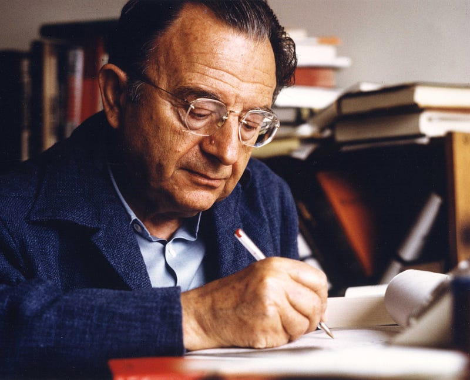

{fig-alt="Image from Wikipedia"}

Erich Fromm doesn’t come up in conversation outside of academic circles related to psychology, psychoanalysis, or maybe sociology. This wasn’t always true. Fromm was a widely known and discussed figure in his day. His seminal work, “Escape from Freedom” (1941), and his international best seller, “The Art of Loving” (1956), made him and his ideas popular beyond academia. Having recently reread *Escape from Freedom*, I realized how relevant his ideas remain, not only in the U.S. but throughout the world.

My goal with this piece is to (re)introduce Fromm and provide some thought starters as to why he remains as relevant today as he did back when he published his famous works (1941–1970s).

First, a quick background on Fromm. Erich Fromm was a Frankfurt born (1900) German-American social psychologist, psychoanalyst, and humanistic philosopher renowned for his contributions to critical theory, social psychology, psychoanalysis, and his critique of modern capitalist society’s effects on the human psyche. Many of his ideas and approaches were framed from having been a German during the rise of Nazism. He left Germany after the Nazis took power, first landing in [Geneva](https://en.wikipedia.org/wiki/Geneva) and then moving to New York in 1934 where he taught at [Columbia University](https://en.wikipedia.org/wiki/Columbia_University). Fromm was a member of the Frankfurt School, a group of theorist/philosophers of social theory and critical philosophy associated with the Institute for Social Research at Goethe University Frankfurt (Source [Wikipedia](https://en.wikipedia.org/wiki/Frankfurt_School)). At 79 he passed away in Switzerland (1980).

#### **Escape from Freedom**

Let’s start with one of Fromm’s most famous works, “Escape from Freedom” (1941). This book is probably his most important work and it is considered a seminal work in critical theory, social psychology, and psychoanalysis. In this book he explores how the human quest for freedom can paradoxically lead to feelings of isolation and powerlessness, and how individuals seek to escape this freedom through various means such as authoritarianism and submission to authority.

The book offers a critique of modern capitalist society, its effects on the human psyche, and how it shapes individuals’ personalities, behavior, and well-being. He contends that in capitalist societies, people are free to pursue their own goals and desires, but this freedom often leads to feelings of alienation and a lack of connection to others.

This concept of “escape from freedom” remains relevant today. Fromm’s insight that our struggle with freedom can lead to isolation illuminates a striking paradox in modern society: despite unprecedented personal liberty and connectivity, loneliness has reached epidemic proportions. What Fromm identified as the existential burden of freedom seems to manifest in today’s digital age as chronic social disconnection. Loneliness among those in the U.S. has been increasing for years and made worse since the pandemic. For more details on the pandemic of loneliness see this [Harvard study](https://mcc.gse.harvard.edu/reports/loneliness-in-america) or this report published pre-pandemic by [Cigna](https://newsroom.cigna.com/loneliness-in-america).

Powerlessness is also a prevalent issue among U.S. residents. In a 2015 [piece](https://www.weforum.org/agenda/2015/04/why-do-so-many-americans-feel-powerless/) for the World Economic Forum, [Robert Reich](https://www.weforum.org/agenda/authors/robert-reich) wrote about the increasing feeling of powerlessness among the U.S. population. He attributes this to decreased choices in everything from employment opportunities to how companies treat their customers. Just as Fromm predicted, this widespread sense of powerlessness has triggered reactions that seek to restore autonomy — it’s no wonder that the pandemic accelerated both the ‘Great Resignation’ and ‘quiet quitting.’ These movements represent precisely what Fromm would recognize as attempts to reclaim personal power after years of growing alienation in modern economic structures.

#### Social Character

Fromm’s work on the concept of “social character” is also notable. With this concept, he argues that the personality structure of individuals is shaped by the societal pressures and economic conditions of the society they live in. He suggests that the social character of capitalist societies is characterized by “marketing orientation,” that is, by the need for economic success, material possessions, and the fear of losing social status.

These societal structures lead to conformism and lack of individuality. The function of marketing orientation is that is helps maintain the status quo. Everything is seen as a transaction. People “sell” themselves, everything from their personal appearances and personalities to their job skills. For example, we call applying for a job as marketing or selling your skills to get hired.

Fromm observed that too much freedom without meaningful connection creates a sense of alienation due to the loss of community. This allows for some orientations to be more prone to authoritarianism and automaton conformity, which is surrendering one’s individuality to become part of something larger. In this state, individuals become more susceptible to authoritarian appeals. Like much of marketing, the most powerful political messages work through emotion more than logic. Fromm would likely recognize today’s political landscape through this lens: authoritarian leaders succeed not primarily through logical arguments but through emotional appeals that promise belonging and collective identity. Those who promise group identity would succeed even if seen as potentially authoritarian. In essence, they offer relief from the existential burden of isolation. That is precisely the ‘escape from freedom’ that Fromm identified decades ago.

**Human Needs**

Fromm’s work on the concept of “human needs” is another important aspect of his work. He argues that human needs are not limited to physical survival but also include emotional, psychological and spiritual needs. He emphasizes that the satisfaction of these needs is necessary for human happiness and well-being.

The human needs that Fromm outlined are:

**Relatedness **— simply put, this is the need to connect with others. This can be through love, friendship, or any productive relationship, but it can also come through a distortion of a relationship as in submission and domination.

**Transcendence** — this is the drive that gives us purpose. It is the act of purposeful behavior and not just reacting to a situation. Transcendence can be expressed through creating, be it art, writing or even moral action. On the malignant side, it can also express through destruction and cruelty.

**Rootedness** — is the need to seek belonging and connections to our origins. As humans we seek family, community, and traditions. This creates a sense of being grounded in something beyond ourselves in modern society. Unfortunately, it can also manifest as attachment to authoritarian rule and regressive dependence.

**Sense of Identity** — we need a stable self to thrive within a society. Authenticity and uniqueness are pillars of self identity but we can also get a sense of self in a malignant way through conformity, status-seeking, and identifying with things outside ourselves (for example work or addiction).

**Frame of Orientation (and Devotion) **— we need a system of values, beliefs, and goals. As we become separate from the natural world, we seek something bigger than ourselves. We can achieve this through religion, art, ideology but also through blind fanaticism.

Different social systems have varying ways of encouraging how we meet these needs. According to Fromm, a sane society would encourage freedom, love, creativity, and responsibility, but our capitalist society distorts these and instead encourages material gains, competition, and distorted identity.

#### How important is Erich Fromm today

Overall, Fromm’s work continues to be influential in the fields of sociology, psychology, and philosophy. In some circles, his ideas continue to be discussed, especially around topics of consumerism, capitalism, and human freedom.

His critiques of consumerism and materialism in capitalist societies, and his emphasis on the importance of human freedom and self-actualization, remain relevant in today’s world. In a world where authoritarian ideas are becoming increasingly normalized, it is important to step back and critically analyze why we are once again heading in that direction across the globe.

His work on human needs also continues to be important as it emphasizes that the satisfaction of emotional, psychological, and spiritual needs is necessary for human happiness and well-being. This is a crucial reminder in today’s world that focuses heavily on material success and economic growth.

#### **Conclusion**

Fromm’s insights transcend their historical context precisely because they address timeless human struggles. As we face rising authoritarianism, accelerating technological change, and deepening alienation in the digital age, his framework offers something uniquely valuable: an understanding of freedom that acknowledges both its promise and its perils. Consider the rise of social media and its effects on identity formation — platforms that encourage what Fromm would recognize as ‘marketing orientation,’ where users package themselves for likes and followers.

While his contemporaries in the Frankfurt School focused primarily on theoretical critique, Fromm’s emphasis on psychological mechanisms and human potential provides actionable wisdom. What distinguishes Fromm from other critical theorists is his unique integration of psychoanalysis with social theory, offering not just diagnosis but pathways to healing. Where Marx provided economic analysis and Adorno cultural critique, Fromm illuminates the psychological mechanisms that connect social structures to personal experience.

His vision of a ‘sane society’ remains unfulfilled, but his careful diagnosis of our social pathologies — and his hopeful prescription for greater authenticity, love, and productive engagement — offers a compelling alternative to both unbridled individualism and authoritarian collectivism.

As we navigate polarization, ecological crisis, and technological acceleration, his framework for understanding human needs and the social conditions for fulfilling them provides exactly the kind of nuanced, humanistic wisdom our fragmented discourse desperately needs.

#### Other works by Fromm

Erich Fromm continued to publish books and articles throughout his career, up until his death in 1980. Some of his later works include:

“The Art of Loving” (1956) his last book.

“The Revolution of Hope: Towards a Humanized Technology” (1968).

“The Crisis of Psychoanalysis: Essays on Freud, Marx, and Social Psychology” (1971).

“To Have or To Be?” (1976).

---

*Originally published on [Medium](https://medium.com/@zemog/its-time-to-revisit-erich-fromm-beeef10d66c6) on 2025-05-15.*
