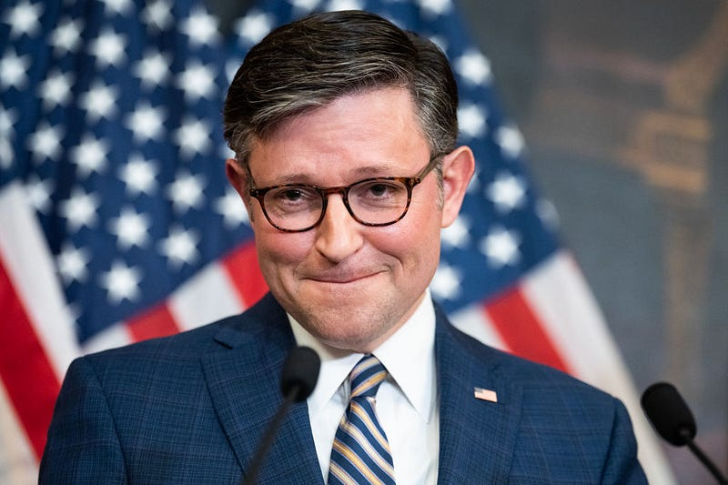

{fig-alt="Image"}

As an independent voter who seeks leaders demonstrating genuine commitment to American welfare, I find myself increasingly troubled by the disconnect between House Speaker Mike Johnson’s words and actions. When Johnson recently called for a “free and fair, legal election across the board,” I couldn’t help but notice a familiar pattern — one that echoes his responses to gun violence, where “[thoughts and prayers](https://rollcall.com/2023/10/26/after-mass-shooting-new-speaker-calls-for-prayer-that-senseless-violence-can-stop/)” consistently substitute for meaningful legislation. He [said](https://www.cbsnews.com/news/mike-johnson-january-6-violence-congress/) that he is praying for — a “free and fair, legal election across the board.”

This pattern reveals a deeper issue in our political landscape. While prayer has its place in personal and public life, it cannot serve as a substitute for governance. When Johnson offers prayers after mass shootings while [blocking](https://thehill.com/homenews/house/4279085-speaker-johnson-says-now-not-the-time-to-discuss-gun-control-problem-is-the-human-heart-not-guns/) basic gun safety measures supported by most Americans — including universal background checks and red flag laws — he isn’t just failing to address the crisis; he’s actively choosing inaction.

The parallel between his approach to election integrity and gun safety is striking. In both cases, Johnson employs the language of concern while avoiding concrete action (where is his outrage about recent [burned](https://apnews.com/article/ballot-drop-box-fires-portland-vancouver-60fea753ceb761624e6aba49f0e9dd99) ballot drop boxes?). His prayers for fair elections, much like his thoughts and prayers for shooting victims, seem designed to deflect rather than address the underlying challenges facing our democracy.

This isn’t about questioning the sincerity of religious expression — it’s about the responsibility of leadership. When children die in school shootings, we need more than comfort; we need prevention. When election integrity is at stake, we need more than prayers; we need robust policies that protect voting rights and democratic processes. Yet in both cases, Johnson’s response follows the same script: offer prayers, avoid action, repeat.

The American public deserves leaders whose actions match their rhetoric. As an independent voter, I’ve watched this pattern of performative concern without follow-through become increasingly prevalent in our political discourse. It’s a strategy that might satisfy partisan bases but fails to serve the broader public interest.

True leadership requires more than well-timed expressions of concern — it demands the courage to take meaningful action, even when that action might be politically challenging. Until Speaker Johnson can bridge the gap between his prayerful words and his political choices, his leadership will continue to exemplify a troubling trend in American politics: the substitution of performative gestures for substantive governance.

---

*Originally published on [Medium](https://medium.com/@zemog/opinion-mike-johnsons-secret-thoughts-and-prayers-and-the-empty-echo-of-action-ac13c2b74150) on 2024-10-31.*
