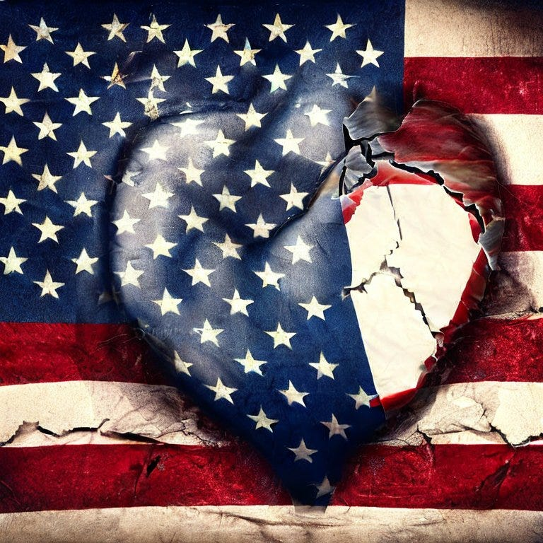

{fig-alt="Image"}

There is no doubt that we are living through a massive attack on personal liberty. For many, this reversal from granting rights to taking away rights signifies the end of democracy as we know it and possibly the start of a sort of fascism. For others, this marks a return to normal, where rights are mostly for the mainstream and where those who are different need to keep their differences private and not expect to exercise then publicly at will.

This latter group believes in liberty as a closed system, where granting rights to one group automatically diminished the rights of others. Said another way, each group has a slice of the liberty pie, and if one slice gets bigger, even if it was the smallest and it was just trying to be the same size as the others, the other slices need to get thinner to make room for the growing but smaller slice. For most this argument makes no sense. Liberty is not finite. My freedom of speech does not diminish if you also have that right.

Throughout history, impediments to liberty usually begin by limiting the liberty of the most vulnerable and least influential groups. Good targets are often:

- foreigners

- groups with different physical characteristics from the dominant group

- skin tone

- eye shape

- hair texture

- groups with different religious views

- groups that speak a different language

- groups with alternative sexual preferences

Today, the liberty limiting playbook remains the same — attack the most vulnerable. These include:

- immigrants — especially if they speak Spanish or have darker skin

- folks with a darker complexion — the use of BLM as a reason to limit the right of black Americans

- religion — Jews, non-Christians

- transgender folks — the latest scapegoats

Limiting the rights of transgendered folks has become so popular, that the leading voices of a major political party (Republican) has made the restrictions of their rights a call to action.

The idea (as opposed to the reality) of this great country wasn’t built on limiting freedom. Our constitution was written to protect life, liberty, and the pursuit of happiness. While these words reflected the rights of white, property-owning men at the time, nothing in the document states that it only applies to this group (sorry Thomas). The constitution is a living document, not the dead sea scrolls.

Our history is a history of the neediest, of refugees, or exiles, and of outcasts. The UK and other settling nations did not send their best to an unknown land — they sent the ones they didn’t want or the ones they didn’t care if they lost. For every famous settler we learn about in the history books, thousands of nameless settlers died. In fact, our country’s philosophy is so open that the most famous statue has this poem written on it.

> “Give me your tired, your poor,

> Your huddled masses yearning to breathe free,

> The wretched refuse of your teeming shore.

> Send these, the homeless, tempest-tossed to me,

> I lift my lamp beside the golden door!”

What seems clear is that the current political and social environment in some pockets of our country don’t share the original ideal vision of why the Unites States was created. This fragile experiment is beginning to crack and only time will tell if it breaks or mends.

Some of you reading this might say — OK, but we’ve had turbulent times throughout history, and we survived as a nation. You are correct, we have, but that does not diminish the urgency of our time.

The current climate did not begin with the election of Trump or the emergence of the Tea Party in response to Obama’s presidency. What has happened is that the in the last two decades or so the intensity of the conflict has increased. The increase is being fueled by the acceptance of hate, racism, discrimination, wealth accumulation, loneliness, and anger in the public sphere. Fearmongers are manipulating human love, chocking it, and causing many to lose it.

Politicians, especially Trump, have tapped into this loss of love and gain politically by encouraging hate. A good portion of the Republican party has also adopted the anti-love message to gain votes. Doubt it? Just watch their speeches on their own websites.

Those of us that care about this country, about the beauty of freedom, about the survival of our democracy need to speak out against this hate. We need to become fierce angels of love. It is time to stop watching from the sidelines and time to spread the message as best you can. Write that politician that spreads hate and shame them. Go on social media and spread the message of love. If you can, support parties, politicians, and organizations that work for human love and defund those that don’t.

We all have grown beyond the idea that this country is a melting pot where everything becomes bland. What we are is a super community made up of different communities in agreement that we are stronger together in the name of liberty that individualized.

We need all to help so we can mend the cracks.

God bless you and God bless America, land that we love.

---

*Originally published on [Medium](https://medium.com/@zemog/we-are-losing-our-ability-to-love-723c574c0c1) on 2023-07-14.*
