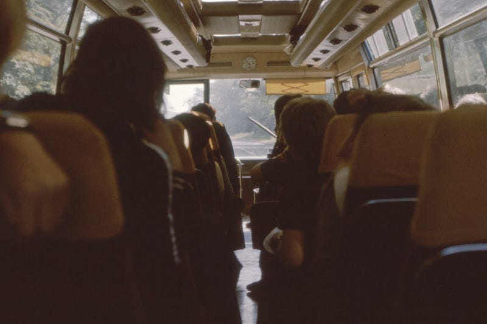

{fig-alt="After FreedomPhoto by Annie Spratt on Unsplash"}

I took a deep breath today

Welcomed the cold air into my lungs

It’s been a long while since I felt rain drops on my skin

Kept in the shadows, alone and quiet

Since I crossed the Grande

It’s been a long while since I felt rain drops on my skin

I exhaled in relief today

The cold wet sand seals my soul like a bung

It’s been a long while since I slept in peace

Bunk beds and florescent

Cold ICE oversees

It’s been a long while since I slept in peace

I ride a Greyhound today

A bumpy thirty-six hours on this steel dun

It’s been a long while since I’ve seen my kids

I hope they see me for me

Greys and all

It’s been a long while since I’ve seen my kids

---

*Originally published on [Medium](https://medium.com/@zemog/after-freedom-cc9c6a4d314a) on 2023-10-30.*
