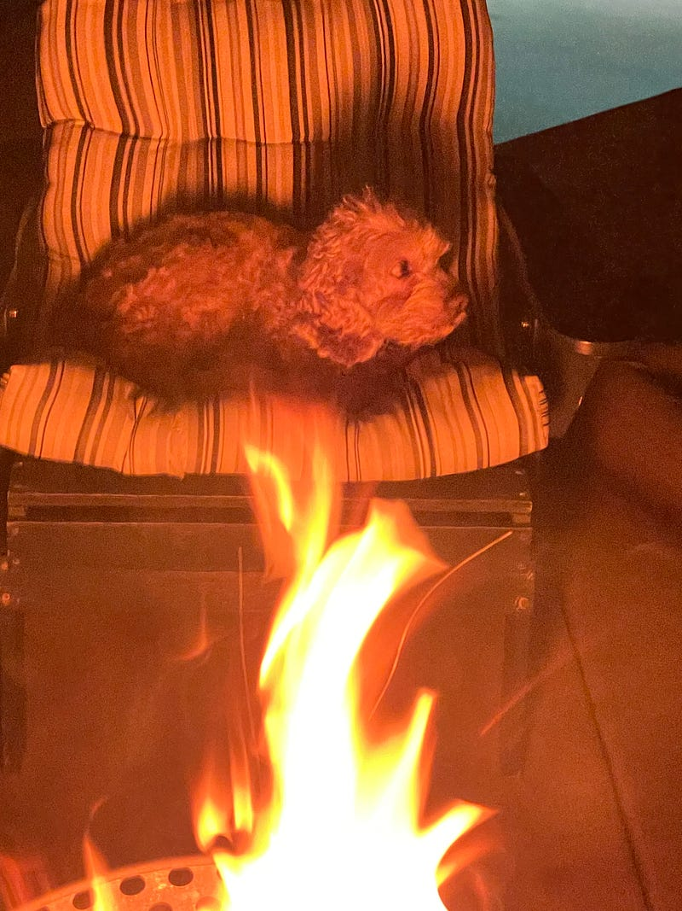

{fig-alt="Photo by G.A.Botero"}

Oh camping, its such a task \
I sit in a leather chair \
in this large tin can.

I wake up early \
for my eggs and ham \
cooked by Juliette \
my camping hand.

I smell the flowers \
freshly picked by Jose \
and delivered to me \
like a giant bouquet.

I go to bed late \
so I can see all the stars \
though these bugs I do hate \
blocking my skylight view of mars.

— -

Short silly poem. Thanks for reading.

---

*Originally published on [Medium](https://medium.com/@zemog/camping-without-nature-64f29a5e2dd3) on 2024-04-29.*
