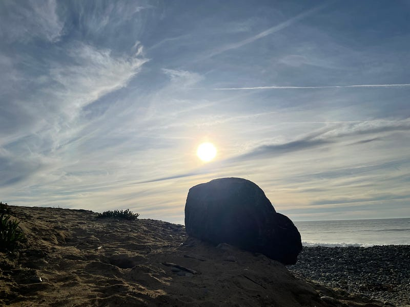

{fig-alt="Boulder than the sun — photo by G.A. Botero"}

It is hard to explain

Unexpected pain swells my heart

Puts a knot in my throat

For no reason at all

\*\*\*

The reason, I can’t tell

It could be the wars on this earthly hell

But it is not, that I know

For no reason at all

\*\*\*

It’s hard to breath

As hard as pushing a boulder through the snow

Who knew the soul could weigh so much?

Puts a knot in my throat

\*\*\*

The beacon in the distance

turned out to be a demon

I couldn’t tell from afar

Unexpected pain swells my heart

\*\*\*

Giving you up

Challenges my addicted soul

I know I’ll come back

It is hard to explain

\*\*\*

The end

---

*Originally published on [Medium](https://medium.com/@zemog/for-no-reason-at-all-1643ee11d46a) on 2024-02-06.*
