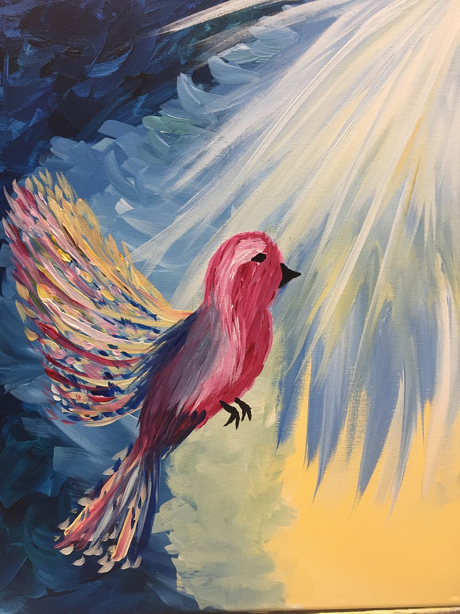

{fig-alt="Painting of bird flying towards a light. Painting by author, G.A. Botero"}

Divided dinner tables, \
unanswered calls, \
muted social media feeds \
deleted texts from all

Wary first dates, \
old friends too \
peace over principles? \
the thorn is so much larger than the white rose.

Connection despite contradiction. \
Sometimes it’s fun over politics, \
but often it’s goodbye \
for mental self healing to form.

---

*Originally published on [Medium](https://medium.com/@zemog/love-in-the-time-of-trump-687076885fdd) on 2025-02-19.*
