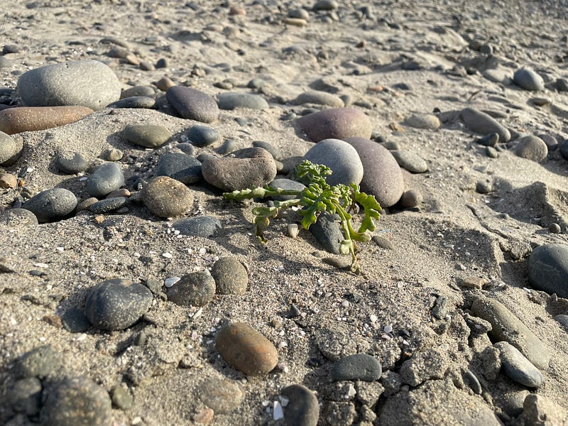

{fig-alt="Image"}

Pictures of you \
last dance \
disintegration for me too \
 \
The fantasy came to me \
a beautiful lie; \
Was it a dream? I am free \
 \
Now at 40 \
I plan a new year’s day \
with no red light to stop me — \
 \
I will live!

---

*Originally published on [Medium](https://medium.com/@zemog/release-b98176fadc48) on 2024-05-02.*
