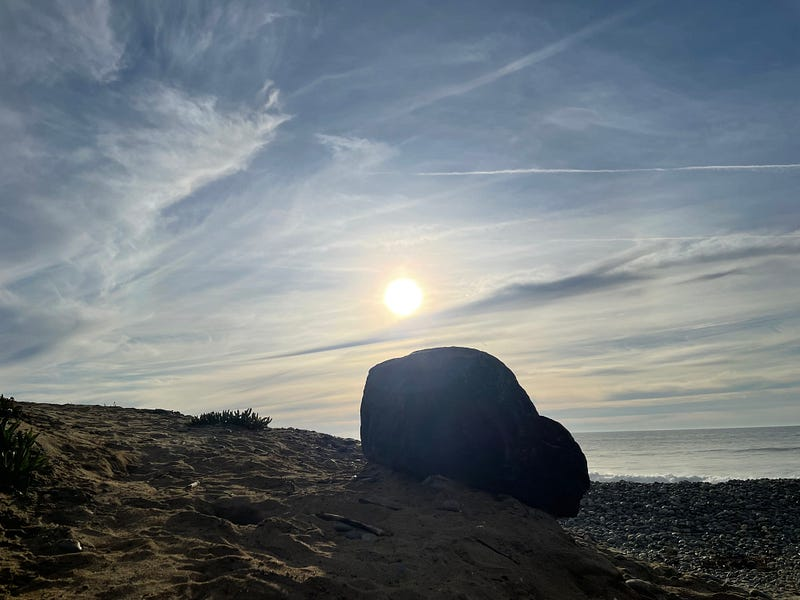

{fig-alt="Photo by G.A. Botero"}

Everything is dark as shit; we are all \
clinging for the last bit of light. \
Long gone are the days when we were all sunny, \
innocent and free from the war of hate that consumes us. \
Perpetual cataclysmic is the new normal. \
Sunken is the light that feeds the soul; let’s \
elope to a different time and see the light again.

---

*Originally published on [Medium](https://medium.com/@zemog/sunken-is-the-light-that-feeds-the-soul-40df63f52d9c) on 2024-05-12.*
