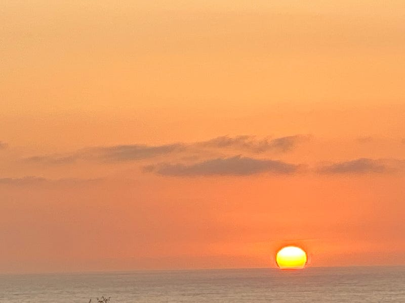

{fig-alt="California Sunset— G.A. Botero"}

What is love? you ask me as you watch the horizon draped in sunsets, \
it is a sigh that the soul exhales, \
It is the shadow that follows our steps.

It is the passion that runs through our veins \
like a comet flying, untethered, through the cosmos

That is love.

---

*Originally published on [Medium](https://medium.com/@zemog/that-is-love-9c7b17637049) on 2025-02-18.*
