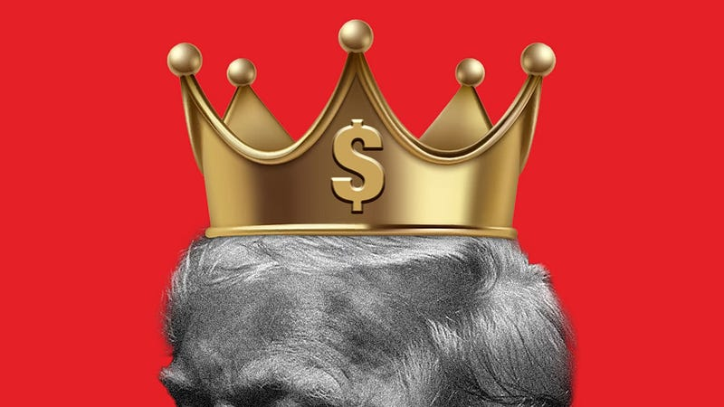

{fig-alt="Image found online"}

You must have heard \
it has been said \
the crown just sailed \
above his head

It landed softly \
and hurt no strand \
the colors loudly \
like gold and spray tan

They all would laugh \
but would not dare \
to show their teeth \
or fight his snare

He ate the rich \
and ate the poor \
and never done \
he ate some more

The press was silenced \
as so too of speech \
Scientists could only study \
the golden peach

Late night tweets and so called truths \
confused the generals and most of the troops \
and too his aides and all the followers \
was it true, the golden showers?

The genius spoke \
with simple words \
regurgitated by foxes \
their tails unnerved

but truth be told \
we all should frown \
we all lost \
the day the clown wore the crown

---

*Originally published on [Medium](https://medium.com/@zemog/the-clown-who-wore-a-crown-10d7558ef1e6) on 2025-06-02.*
