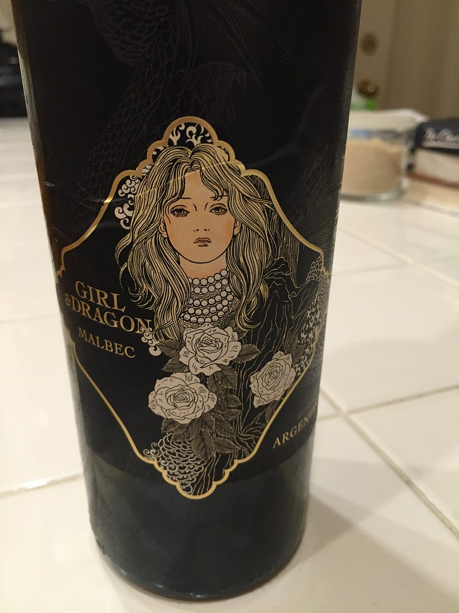

{fig-alt="Wine bottle — Girl & Dragon"}

Moon of tinted glass, \
how you pierce the throat of night. \
The hibiscus trees weep poison. \
They weep poison.

In the yard, crows circle \
an empty chair where my father sat. \
His shadow drinks from red rivers, \
rivers that flow nowhere but down.

The crickets know my name. \
They scrape it against their legs \
while K-9’s urinate on the rosemary leaves, \
dry and yellow in morning light.

Three glasses stand like eucalyptus trees. \
Three graves of crystal. \
My father’s voice shook \
like wind-torn leaves. \
Like wind-torn leaves.

The moon fills each glass with the nectar, \
with memory, with thorns. \
Below consciousness, a river flows. \
Red river. River of thorns. \
River of no return.

---

*Originally published on [Medium](https://medium.com/@zemog/the-green-bottle-f0886e9cd875) on 2025-01-06.*
