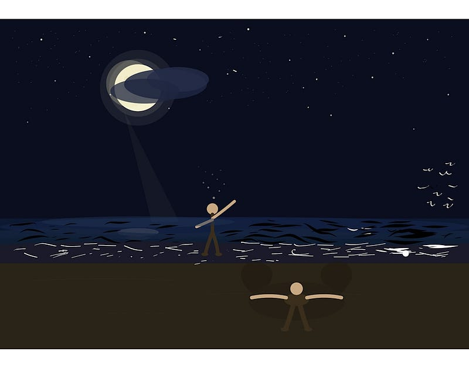

#### Poetry

{fig-alt="Picture by me via Adobe Illustrator"}

I held it in my hands \
Tightly squeezing my grip so it would not get out \
I could feel it struggle as the light that fed it disappeared \
My heart grew strong, as did my courage \
I knew it was for the best, I had lived with it for too long \
As long as I could remember, really. Forever! \
It was part of me, but no longer

\*

I looked at my hands \
Palms together, strongly pushing against each other \
I sensed that it had shriveled to specks by now \
No longer a threat, no longer attached to me \
I felt relief, the pressure seemed to have gone \
I cupped one hand on to the other and poured the imaginary ashen dust into my right palm \
I closed my eyes and threw the hardest pitch towards the susurrating sea; \
anything left would soon dissolve in the salty waters of the Pacific

\*

I fell back into the soft sand \
I did snow angels as I stared at the moon \
I cherished the rebirth \
“A new life,” I thought \
I can finally be me — free \
Free from what has possessed me \
I closed my eyes; the cold ocean water touched my toes

\*

I jumped back up \
full of spirit \
I knew there was no going back \
A cloud covered the bright white moon \
A cold breeze hit my skin \
I started to shiver, the hairs on my skin rose in excitement \
My fear was back, it didn’t take long to come home.

---

*Originally published on [Medium](https://medium.com/@zemog/what-comes-back-da087b3795f4) on 2026-05-06.*
