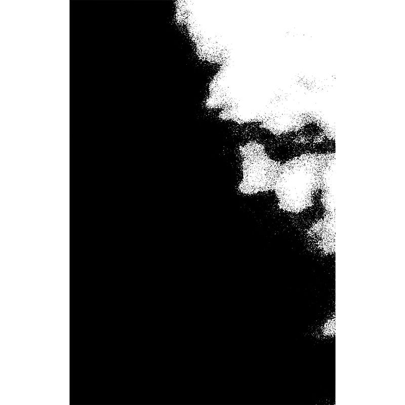

{fig-alt="Image"}

I moan all day \
I moan all night \
Just like cats after a fight \
 \
My claws are strong \
My claws run deep \
They tend to hurt most in my sleep \
 \
I cut for pain \
I cut for pleasure \
The blood that drips relieves the pressure \
 \
Today I weep \
Today I cry \
For all my fears that have to die

---

*Originally published on [Medium](https://medium.com/@zemog/wounded-soul-6bbae011c68f) on 2024-04-30.*
