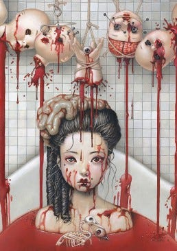

{fig-alt="Art attributed to Trevor Brown"}

It probably won’t matter at the end, you see, \
they were already dead when they got to me. \
 \
They yap as babies do, \
but they sound like growls to me and you. \
 \
Grinding their little teeth, \
salivating at the sight of my flesh for them to eat. \
 \
I took the blade that Michonne had laid, \
and slashed them up and you called it ‘well played.’ \
 \
To bath in the blood of the young dead, \
provides my soul of its needed bread. \
 \
Rejuvenates my skin, \
and shines my raven hair that was dim. \
 \
Now it is your turn, jump right in. \
If you wait too long, you might realize the sin.

---

*Originally published on [Medium](https://medium.com/@zemog/zombie-baby-spa-f2047d635d54) on 2023-11-04.*
