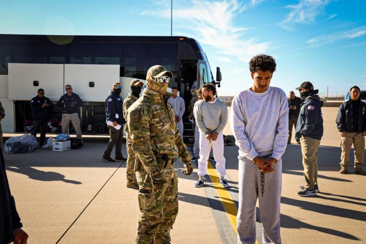

{fig-alt="DHS image of migrants from the 1st flight to Guantánamo Bay. Common Weal mag"}

My dear Maria,

As I write this to you, the rain taps against our apartment window. It reminds me of the day we first met. Remember that day? We both were running into that crowded Peacock cafe in the village, seeking refuge from the heavy summer storm. You were fumbling with your phone looking for some sort of document, and I was praying that my dying phone last long enough for me to use my ApplePay to buy an espresso. I bumped into you, our eyes met, yours angry and mine in sudden heaven. Despite the masks we still occasionally wore out of habit, I knew you were smiling beyond the evil stare.

We thought the chaos of the world would end soon as things were getting back to normal. The world was recovering from the pandemic and the return of a career politician to the White House suggested at least a grounding in the familiar. We weren’t yet navigating the current ideological transformation or AI companions being forced on us by every company out there. The most heated topic was arguing about whether remote work was worth it and how long we should keep wearing masks.

All this I recall from the rain tapping against my window but, I find myself mostly thinking only of you.

The news today was unbearable again. The unthinkable romantic bromance between the U.S. and Russia has sent shock waves through the world, Europe and NATO. Much of the world stands deserted from the promise of what the U.S. meant to be a pillar of democracy. I know much of our fight for freedom around the world was fiction but the alternative of a bunch of wannabe strongmen running our country is not only disheartening but scary. My colleagues from Ukraine spent lunch in real, not figurative, tears worried for their country and families back home. How quickly decades of alliances can unravel.

Last night, the raids were back in our neighborhood. The ICE sweeps have intensified since the executive orders last week. Remember the Ramirez family from 3C? Gone overnight including their two U.S. born kids. We later heard through community networks they were separated at the Newark processing center. Mr. and Mrs. Ramirez were sent to the newly reopened detention facility at Guantanamo without a hearing. And no one can locate the children. Their cousins have been making phone calls and calling representatives without much luck. Can you believe they lived here for fifteen years and had their lives destroyed in one night. Unimaginable just a few weeks back.

How I wish you were here with me. It would make this all much more bearable. I miss your voice, your scent, and your warmth.

Yesterday on the news they showed hundreds of people in gray jumpsuits at a military airfield, boarding large transport planes. These folks were going to be shipped to countries that have agreed to take immigrants from the U.S. in exchange for kindness from our POTUS. The administration claims these are criminals but sources have identified many who don’t have as much as a traffic ticket. Some having lived here legally, as refugees, for decades. The courts are overwhelmed and most detainees never see a judge. I had a staff member not show up to work on Monday. He later texted me saying his family decided to go back to Mauritius. The harassment was just too much for them. Even though they had Green Cards their characteristics had resulted in them being detained several times and having to prove they were in the United States legally.

In these troubled times, our little apartment has become a sanctuary. Before the world fractured along new and terrifying lines, you and I create our own reality here. I recall how you laughed at how I still download movies “just in case” the network went down, and I tease you about your collection of figurines that adorned every free space of our nook.

The uncertainty of our times has only made what we’ve built more precious. I still have many of the figurines. What use to be so annoying has become comforting in your absence. While the world debates the current state of affairs, we created this small universe that belongs just to us. Your hand in mine was the one constant in a world that violently shakes itself with each passing day.

I miss our whispers in the dark about whether we should join the underground railroad network to help families escape from ICE. Who knew then that so many would already be gone. Is it brave to stay or brave to leave? I don’t know anymore. But I know that whatever comes, I will face it with you as my guardian angel.

I marvel at how we live in these strange, transformative years. Future generations will be amused by our primitive smart homes and our primitive minds. They might wonder why we ignored, for decades, the early climate changes and why we invested billions to reach Mars rather than fixing our own planet.

They might also judge how we responded to the humanitarian crises of our time as we did when we learned about WWII. I am glad we never had children because I would not be able to bear the questions of how many just stood by and only a few stood up. I hope you understand how difficult it is to wake up everyday to witness fresh horrors and new lines crossed that once seemed uncrossable.

My only hope is that humanity will see what remains unchanged — how love still anchors us when everything else shifts. How finding one person to share your life with, to witness your story, remains the greatest adventure of all even if that adventure was not in the cards for us. And while most of me misses you, there is a small part that is thankful you left peacefully because your big heart would break daily if you witnessed what our life has become.

Until tomorrow and all our tomorrows after. I pray that one day our souls will meet again.

Yours, always

Francisco

---

*Originally published on [Medium](https://medium.com/@zemog/my-love-life-has-changed-6d708366d85d) on 2025-04-10.*
