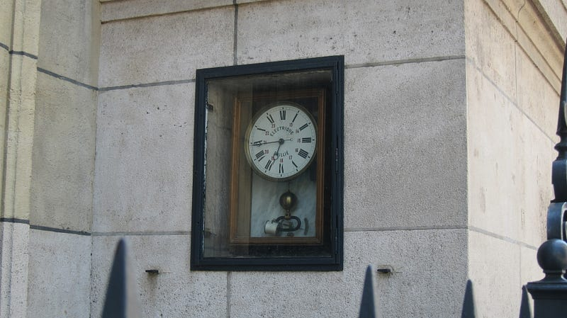

{fig-alt="Photo by G.A. Botero. Somewhere, time moves in Paris"}

In the coastal community of Encinitas, where the scent of salt mingled with the sweetness of sunscreen, perfume, and overripe egos, I discovered that time had forgotten how to move forward on an otherwise unremarkable Tuesday afternoon. It happened while I was watering the majestic magnolia tree — a tree that at over two hundred years old had witnessed drastic changes to the community, including revolutions, fires, floods, and urban development — when the church bell, recently restored, attempted to toll three o’clock and found itself unable to complete the task.

The sound hung in the air like a question, unfinished and waiting. The puffy clouds wandered without purpose and the songbirds grew quiet. The murder of crows settled on the nearby trees and whispered to each other, confused and astonished. I too felt the peculiar sensation of the present moment stretching beyond its natural boundaries. I confirmed the static nature of time as I looked at my iPhone for what seemed like five minutes without a time change. The iPhone too had no explanation.

“Abuela,” I called. “Something has happened to the time.”

Lolita was not my biological grandmother but someone whom I had always known and had always lived in our house. She and my grandmother had been like sisters, growing up together as children when our large house was much smaller. Lolita, at ninety-seven, remained very active. She could recall the exact shade of blue in her wedding dress, the precise temperature of the rain that fell the day her husband died, and many other things most people forget or never knew.

Lolita slowly looked up from the dress she was embroidering with butterflies. Throughout the year she would sew and embroider beautiful dresses for the annual midsummer festival. The locals swore that the butterflies would sometimes detach themselves from the fabric to pollinate the jacaranda trees that lined the street, although I had never witnessed it myself.

“The time, hijo,” she said without surprise, “has stopped flowing again.”

“What do you mean?” I replied, expecting her to answer with her contagious smile, but she continued without one. “It happens every fifty years or so,” she explained, “when the past grows too heavy and the future too impatient.”

I glanced at my wristwatch, a gift left to me by my father before he walked into a morning mist thirty years ago; they say he simply became one with the ocean air. The watch’s second hand trembled in place, desperately trying to tick forward.

“What should we do?” I asked.

She set down her embroidery. “We must go to where the old plaza stood. When time forgets itself, it often remembers there. Let’s hope the stones are not too upset with us.”

Encinitas exists in a perpetual state of sun-drenched melancholy. Its buildings, like its people, stand and live in a way that defies conventional description. The ambience is one of constant forgotten promises with a healthy dose of distant memories. These lean toward each other in eternal conversation. The old folks have adapted to peculiar phenomena over centuries: the rain that fell only on birthdays, the parish priest whose shadow arrived a day before he did, the librarian whose tears transformed into tiny transparent fish that swam through the air toward the ocean. I, for one, believed the tales of the rain and the parish priest, but I drew the line at the flying fish.

As I walked through the streets beside Lolita there were places where the dust refused to settle in the suspended moment. Folks emerged from their homes, each experiencing the cessation of time in their own way. Mrs. Owens stood in her doorway, a spoonful of sugar about to enter her espresso, eternally floating. The Chen family, usually very loud, sat quietly around their small table playing a game of cards where every hand was simultaneously won and lost, creating an incomprehensible feeling of triumph and defeat.

“It’s the season of time-forgetting,” Lolita explained to the confused Frank, the butcher, whose cleaver was frozen mid-chop above a cut of meat that would never know its fate. “We are going to where the plaza stood to remind the foundation of its duty.”

The Plaza, long forgotten and many times built over, sat at the heart of what was known as Old Encinitas. The ancient cobblestones worn smooth by generations of lovers who came to whisper secrets into the ear of the now removed bronze statue of the town’s founder lay under layers of asphalt. Today, the strip mall that stood in its place was crowded with townspeople who had naturally, but without explanations, reached this area, moving with the deliberate slowness of those navigating through honey.

In the corner of the parking lot stood an old clock stand, about four feet tall, an old timepiece preserved to commemorate the once great Plaza that stood here. The clock — Infinite Moments — was a timepiece crafted by an Italian horologist who fell in love with a local woman, rumored to be Lolita’s grandmother, whose beauty drove him to madness and genius in equal measure. The clock, with its numerals and hands of different metals — copper for the past, silver for the present, and gold for the future — had stopped, all hands pointing to the thirteenth hour, which existed only when time forgot itself.

“What we need,” Lolita said, her voice carrying the weight of ancestral knowledge, “is to remind time of a moment so significant that it cannot bear to miss what comes next.”

Lolita opened her long sweater, revealing embroidered butterflies in the inner lining. The butterflies began to flap their wings. Slowly, the threads of the sweater unraveled as the butterflies, released from their present state, began to fly, encircling the clock. I held my father’s watch and could feel its pulse. People sang and wept. Some had rain fall on them to release the passion dimmed by time. Keys jingled in people’s pockets to unlock stubborn memories.

“Time,” Lolita addressed the clock directly, her voice carrying the authority of someone who had witnessed ninety-seven years of its faithful service and occasional rebellions, “we understand your weariness. The burden of recording every joy and sorrow, every birth and death, every freedom and every dream, every significant moment and every mundane minute must be exhausting.” She paused, closed her eyes, and continued, “but without you, we cannot move forward into what awaits us, be it good or bad.”

With that, the clouds began to drift in the sky once again.

---

*Originally published on [Medium](https://medium.com/@zemog/the-afternoon-when-time-forgot-itself-30640ad70645) on 2025-04-16.*
